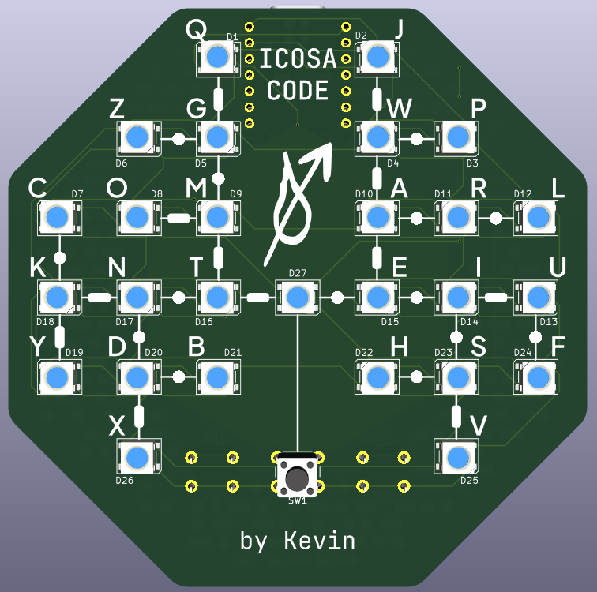
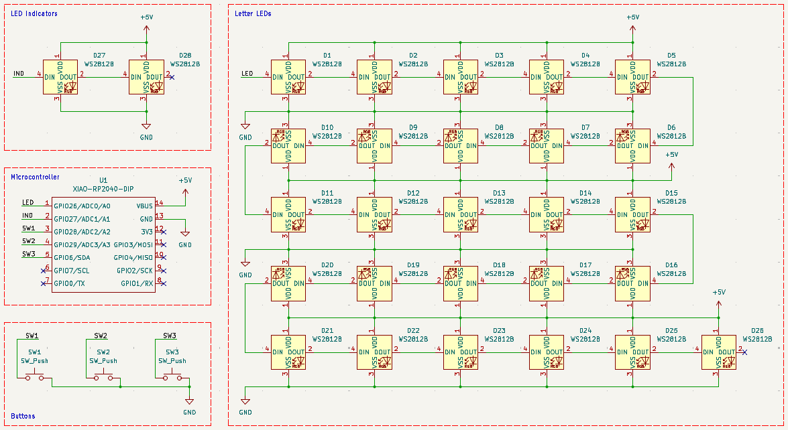
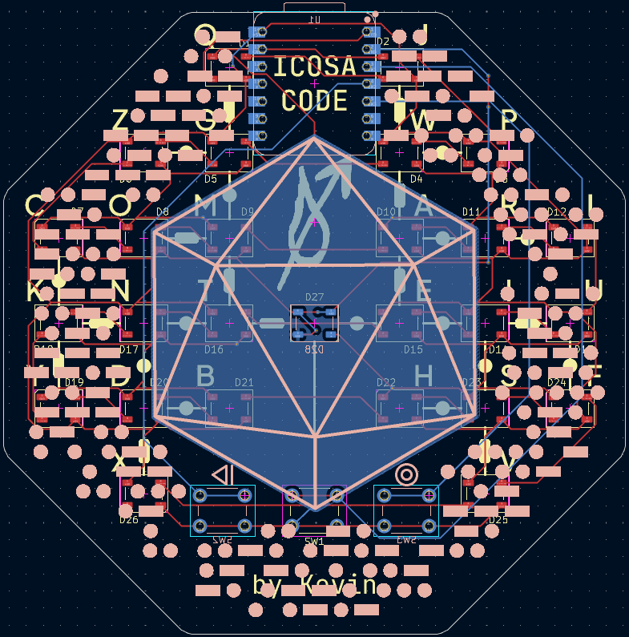
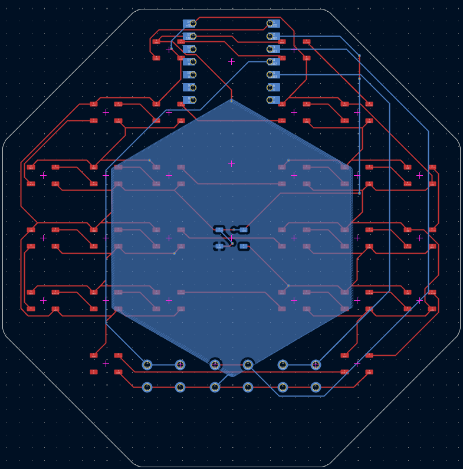
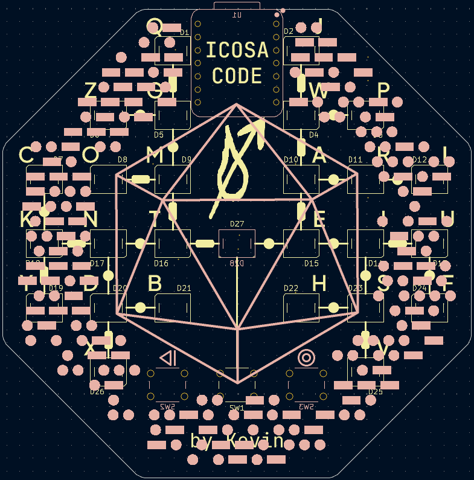
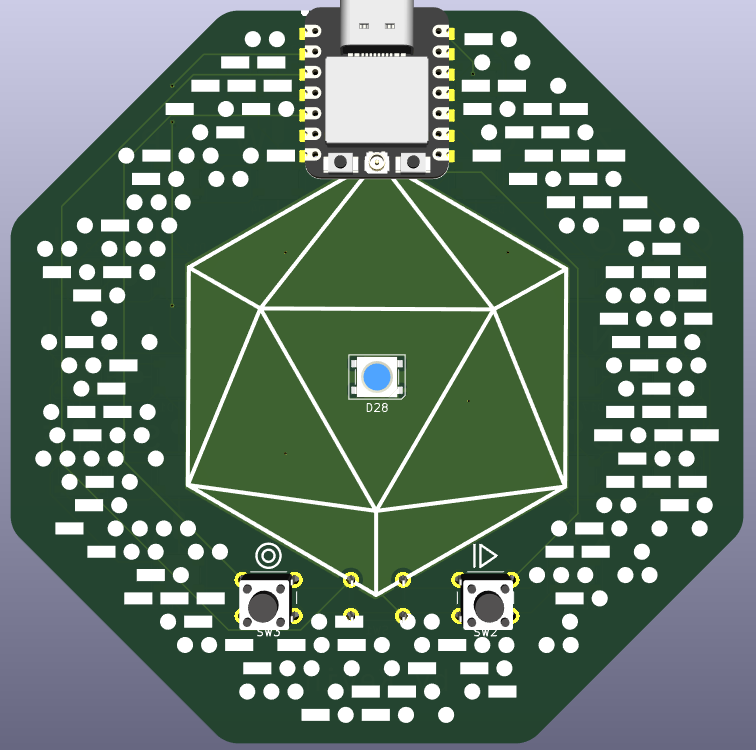

# Icosa Code

A pocket-sized Morse Code decoder with a button and LEDs.

## Details
PCB made in **KiCad** 
Firmware in **CircuitPython**

## About

## Images

### Schematic

### PCB

| Complete | Copper Routing | Silkscreen Graphics |
| - | - | - |
|  |  |  |

### Board

| Front | Back |
| - | - |
|  |  |
