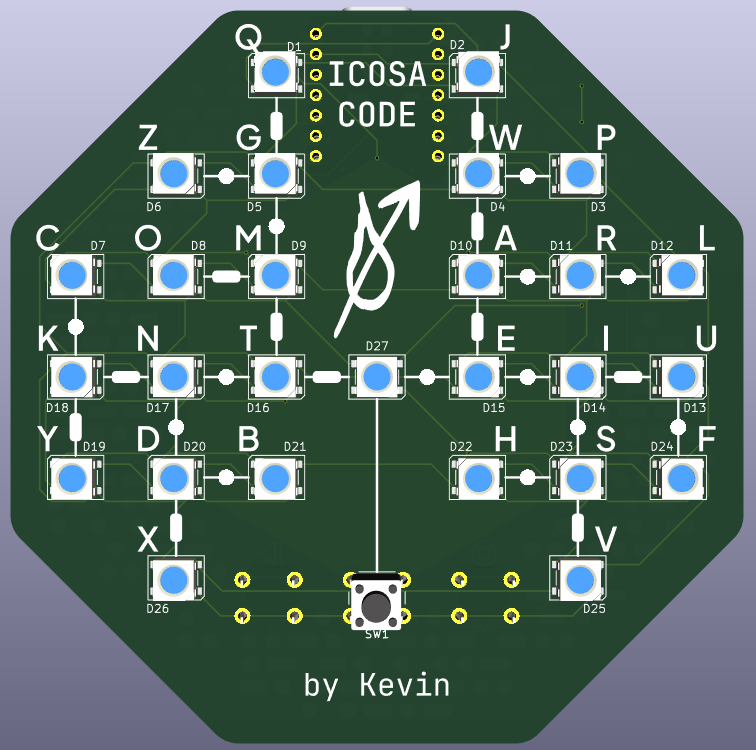
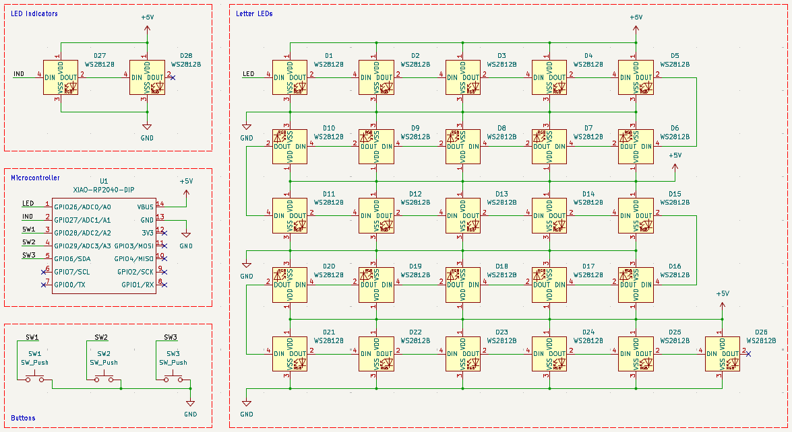
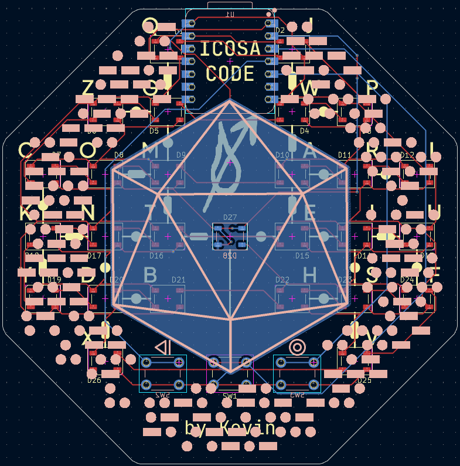
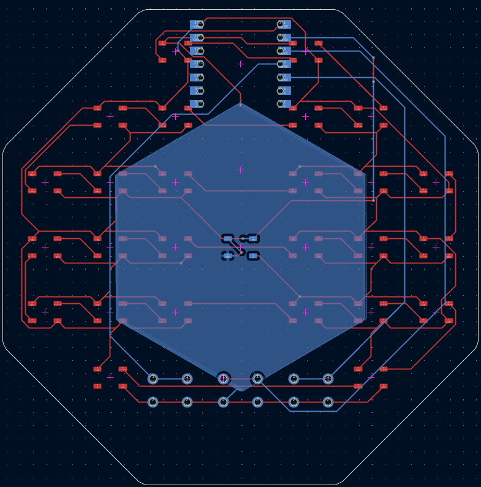
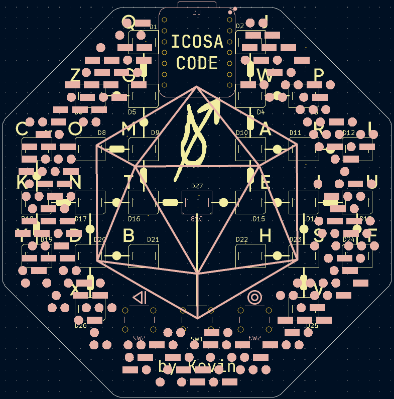
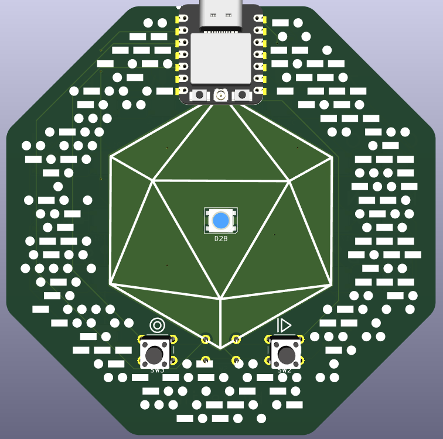

# Icosa Code

A pocket-sized Morse Code decoder with a button and LEDs.

## Details
PCB made in **KiCad** 
Firmware in **CircuitPython**

**Components**:
- **Seeed Studio XIAO RP2040**: Microcontroller
- **Neopixel WS2812B (5050 SMD)**: LEDs
- **6x6x5mm Tactile Push Button Switch**: Push Buttons

**Features**:
- Live **Morse Code decoding** on the LED graph
- **Status indicator** LED
- **Record and replay functionality** with two buttons

## About
Inspired by the [nux Morse Code Card Pro](https://nux-modellbau.de/en/g41731.2/nux-morse-code-card-pro),
this project is an open-source Morse Code decoder, originally made for week 5 of
Hack Club's Half Life. It has a graph where the nodes are LEDs representing letters
and the edges show dots and dashes.

The LED graph is arranged as a grid, fit inside a regular octagon. The microcontroller,
status LED, and record/play buttons are on the back of the board, surrounded by a message
in Morse Code on the silkscreen, with an icosahedron in the middle.

## Images

### Schematic

### PCB

| Complete | Copper Routing | Silkscreen Graphics |
| - | - | - |
|  |  |  |

### Board

| Front | Back |
| - | - |
|  |  |

## BOM

Item  | Description  | Quantity  | Source  | Cost  | Amount
--- | --- | --- | --- | --- | ---
Seeed Studio XIAO RP2040 v1.0  |  Microcontroller  |  1  |  [Robu](https://robu.in/product/seeed-studio-xiao-rp2040-v1-0/)  |  $5.60  |  $5.60
WS2812B SMD 5050  |  Neopixel LEDs  |  28  |  [Punoscho](https://punoscho.in/pr-addressable-led/)  |  $0.07  |  $1.96
6x6x5mm Tactile Push Button Switch  |  Buttons  |  7  |  [Robu](https://robu.in/product/6x6x5mm-tactile-push-button-switch-pack-of-20/)  |  $0.02  |  $0.14
PCB  |  The board  |  1  |  [JLCPCB](https://jlcpcb.com/)  |  $4.00  |  $4.00
Estimated total shipping  |  -  |  1  |  -  |  -  |  $11.47
TOTAL  |  |  |  |  |  $23.17
